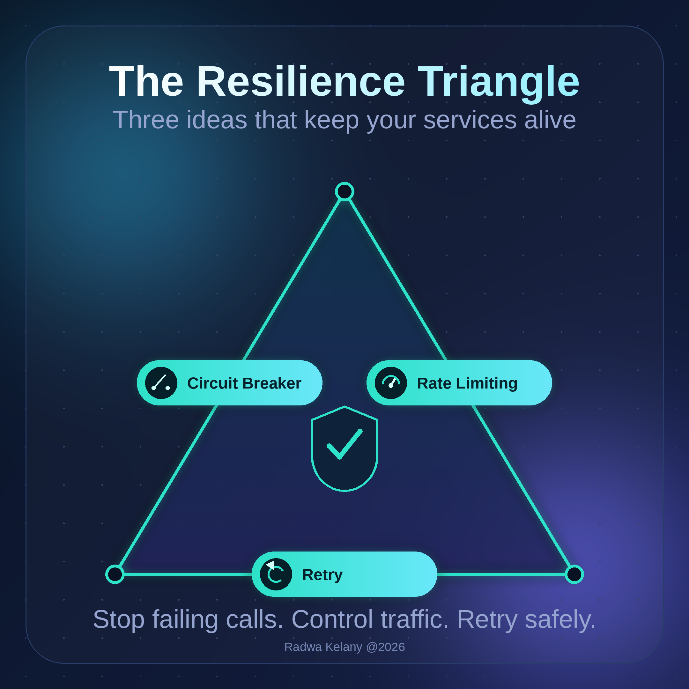
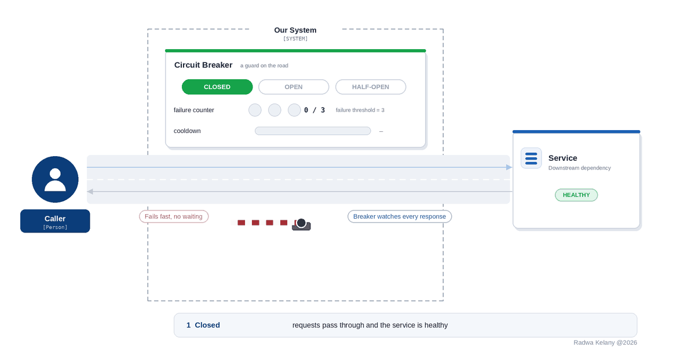
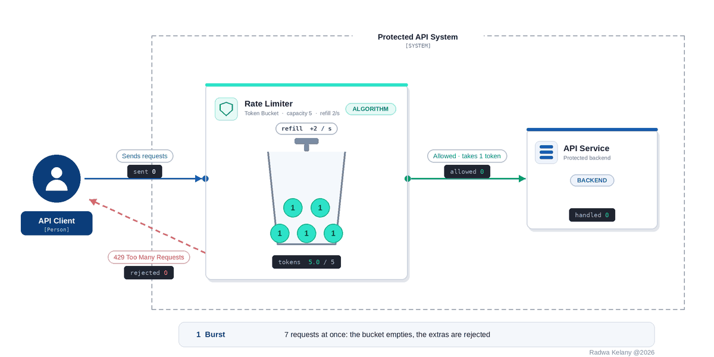

# The Resilience Triangle

Three patterns that keep an application working when things go wrong: **Circuit Breaker**, **Rate Limiter** and **Retry**.



---

## Why resilience matters

Modern applications rarely work alone. A single user action can call a database, a payment service, a search API and several third-party providers. Every one of those calls can fail: a server crashes, a network drops, a deployment goes wrong, or a provider simply gets too much traffic.

Nobody can build a system that never fails. What you can build is a system that **contains** failures, so a small problem stays small.

Without that protection, one slow dependency can bring everything down:

1. A service becomes slow.
2. Callers keep waiting for it, and their threads and connections pile up.
3. The callers run out of resources and become slow themselves.
4. Their callers start waiting too, and the failure spreads through the whole system.

This is called a **cascading failure**. Well-meant reactions can make it worse: if every client retries at once, a struggling service gets even more traffic. The result is downtime, lost revenue and lost trust, often caused by a failure that started in a minor part of the system.

**Resilience** is the ability to keep working, or to degrade gracefully, when parts of the system fail, and to recover quickly afterwards.

---

## The main idea: the Resilience Triangle

Three simple patterns cover most of this problem. Each one is one side of the triangle and answers one question.

| Side                | The question it answers                          | Status      |
| ------------------- | ------------------------------------------------ | ----------- |
| **Circuit Breaker** | Should I stop calling a service that is failing? | Done        |
| **Rate Limiter**    | How much traffic should I let through?           | Done        |
| **Retry**           | Should I try again, and how?                     | Done        |

**Road analogy:**

- The **circuit breaker** is a guard who closes the road when there is an accident ahead, so nobody waits in a jam.
- The **rate limiter** is a guard at the entrance who only lets in a fixed number of cars, so the road never gets jammed in the first place.
- **Retry** is a driver who tries again after a short wait, but never drives into a road that the guard has closed.

**How they work together:**

```
Request  →  Rate Limiter  →  Circuit Breaker  →  Service
              (how much?)      (is it healthy?)
                                     ↑
                      Retry (only when the failure is temporary,
                             and never while the breaker is open)
```

Each side covers a weakness of the others. The rate limiter keeps traffic under control, the circuit breaker stops calls to a service that is already failing, and retry recovers from short, temporary failures without making an overload worse.

---

## Side 1: Circuit Breaker

**The problem:** calling a service that is failing makes every caller wait for a timeout, and the waiting spreads the failure.

**The idea:** the breaker watches the calls and, when the service looks unhealthy, stops sending requests to it. Callers get an immediate failure instead of waiting. This is called failing fast.

**The three states:**

- **Closed:** requests pass through, and service failures are counted.
- **Open:** when the failure threshold is reached, requests are blocked immediately for a cooldown period.
- **Half-Open:** after the cooldown, one **probe** request tests the service. If it succeeds, the breaker closes. If it fails, the breaker opens again for another cooldown.

**Two details that matter:**

- Only **service failures** count (HTTP 5xx, timeouts, connection errors). Caller mistakes such as 400 or 404 are ignored, so a client error never trips the breaker.
- While the probe is on its way, a **probe flag** rejects every other request. Without it, traffic would flood a service that is still recovering.



**More details:** [reference notes](circuit-breaker/circuit-breaker.md) · [TypeScript](circuit-breaker/circuit-breaker.ts) · [flowchart](circuit-breaker/circuit-breaker-flow-preview.png)

---


## Side 2: Rate Limiter

**The problem:** too much traffic, from one client or from everyone, can overload a service. This also happens by accident, for example with a buggy loop.

**The idea:** a rate limiter decides, for every request, whether there is allowance left. If there is, the request passes. If not, it is rejected immediately with **HTTP 429 (Too Many Requests)**, without doing the real work. It works with two things:

- **Count:** how much allowance is left.
- **Time:** what restores the allowance.

**The algorithms** differ in how they count and how time restores the allowance: fixed window, sliding window, token bucket and leaky bucket. This series focuses on the **token bucket**, which allows short bursts but still enforces the average rate.

**How the token bucket works:**

- The bucket holds tokens, and each request takes one. If the bucket is empty, the request is rejected.
- **Capacity** is the largest burst allowed, and the **refill rate** is the average rate allowed over time.
- Refill is **lazy**: there is no timer. On each request, the limiter calculates the tokens earned since the last request and adds them, capped at capacity:

```
tokens = min(capacity, tokens + elapsed × refillRate)
```

- The code keeps **one bucket per provider** (`providerName`), so one provider running out of tokens does not block the others.



**More details:** [reference notes](rate-limiter/rate-limiter.md) · [TypeScript](rate-limiter/rate-limiter.ts) · [flowchart](rate-limiter/rate-limiter-flow-preview.png)

---