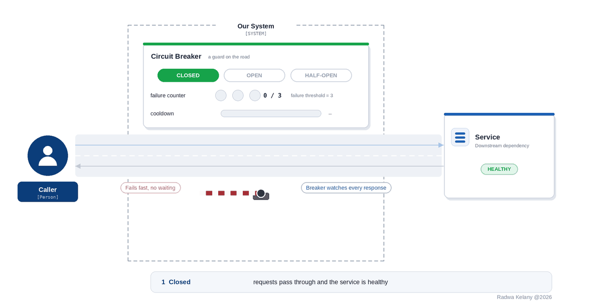

# Circuit-breaker

## Definition and Purpose

### What it is

A circuit breaker protects your system from calling a service that is failing. Think of a guard on a road: if there is an accident ahead, the guard stops traffic until the road is safe again.

### How it works

* While the other service is healthy, the breaker stays out of the way and all requests pass through. In this state, the breaker is called **Closed**.
* When the service becomes unhealthy, the breaker steps in and blocks requests for a while, so callers get an immediate failure instead of waiting. In this state, the breaker is called **Open**.

### Purpose

* Fail fast instead of waiting for timeouts
* Stop one failure from spreading to other services
* Give the failing service time to recover
* Save resources like threads and connections

## Half-Open State and Probing

### Cooldown period

The "while" the breaker stays Open is called the **cooldown period**.

### Probing

When the cooldown ends, the breaker does not send all traffic back at once. It first checks whether the service has recovered, like a guard who lets one car through to test the road before reopening it. This check is called a **probe**.

To probe, the breaker lets a single request (or a small number) through and keeps blocking the rest. In this state, the breaker is called **Half-Open**.

* If the probe **succeeds**, the service has recovered. The breaker returns to **Closed** and normal traffic resumes.
* If the probe **fails**, the service is still broken. The breaker returns to **Open** and blocks requests for another cooldown period.

This cycle repeats until a probe succeeds.

## How the Breaker Detects Failure

### Counting failures

In the **Closed** state, requests pass through and the breaker watches every response. Each **service** failure increases a **failure counter**. The breaker keeps comparing this counter with a configured **failure threshold**.

#### Which failures are counted

A failed response does not always mean the service is unhealthy. The breaker must decide whether the failure was caused by the service or by something on the caller's side. Only service failures increase the failure counter.

**Counted failures (service side)**

* HTTP 5xx responses
* Connection errors
* Timeouts

**Ignored failures (caller side)**

* Client mistakes, such as HTTP 400 or 404
* Requests cancelled by our own side

When a failed response returns, the breaker checks its cause:

* If the cause is the **service**, the failure is counted.
* If the cause is the **caller**, the breaker ignores it. The counter does not change, and no decision is taken.

This keeps the breaker from tripping because of caller mistakes while the service itself is healthy.

### Tripping

When the counter reaches or exceeds the threshold, the breaker concludes that the service is unhealthy. It trips to the **Open** state and starts the cooldown period.

### While Open

Every request that arrives during the cooldown period is blocked immediately, and the breaker stays Open until the cooldown expires.

### Recovery

When the cooldown expires, the breaker moves to **Half-Open** and sends a probe, as described in the previous section.

If the probe succeeds, the failure counter is reset. This prevents old failures from piling up and wrongly blocking future requests.

## The Probe Flag

### The problem

When the breaker moves to **Half-Open**, it lets one probe request through. While that probe is still on its way and has not returned, other requests arrive and see that the road is open. They could pass too, which defeats the purpose of testing the service with a single request.

### The solution: a probe flag

The breaker puts up a sign saying "probing in progress". This sign is a boolean flag called `halfOpenProbe`.

* When the probe is sent, the breaker sets `halfOpenProbe = true`.
* While the flag is `true`, every other incoming request is rejected immediately. Callers get a quick failure instead of waiting, which keeps the "fail fast" purpose and saves threads and connections.
* When the probe returns, with success or failure, the breaker sets `halfOpenProbe = false` and decides based on the result: success returns the breaker to **Closed**, and failure returns it to **Open** for another cooldown period.

### Scope of the flag

The flag is used only in the **Half-Open** state. In **Closed** and **Open** it plays no role, because Closed lets everything through and Open already blocks everything.

## Circuit breaker in action

**Settings:** failure threshold = 3, cooldown = 3 seconds. A caller sends requests to a service through the circuit breaker.

**How to read the diagram:**

* The road has two lanes. The top lane carries requests to the service, and the bottom lane carries responses back to the caller.
* The striped gate is the guard. It is lowered across the road when the breaker is Open, half-raised when it is Half-Open, and out of the way when it is Closed.
* Blue dots are requests. Green dots are successful responses, and red dots are failed responses (5xx). Gray dots are caller errors (400).
* Red dots marked **blocked** are requests that the breaker rejected immediately.
* The amber dot is the probe.
* The panel above the road shows the current state, the failure counter, and the cooldown timer.
* The `halfOpenProbeInFlight` sign appears only in the Half-Open state.

### Phase 1: Closed

The service is healthy, so every request passes through and the responses come back as successes. The counter stays at 0 and the gate is out of the way.

### Phase 2: Counting failures

The service starts failing, and the breaker counts only service failures.

| Request | Response | Cause | Counted? | Counter |
|---|---|---|---|---|
| A | 5xx | service | yes | 1 / 3 |
| B | 400 | caller | **no, ignored** | 1 / 3 |
| C | 5xx | service | yes | 2 / 3 |
| D | 5xx | service | yes | 3 / 3 |

When the counter reaches the threshold (3), the breaker trips to **Open** and starts the cooldown. The 400 in the table shows why caller errors are ignored: a client mistake says nothing about the health of the service.

### Phase 3: Open

The gate is lowered and the cooldown timer counts down from 3 seconds. Each request that arrives is blocked immediately, without being sent to the service. The caller gets a fast failure and no threads or connections are held waiting.

### Phase 4: Half-Open, the probe fails

When the cooldown ends, the breaker moves to **Half-Open** and the gate is half-raised.

1. The next request becomes the **probe**. It is sent to the service, and the breaker sets `halfOpenProbeInFlight = true`.
2. While the probe is on its way, another request arrives and is **rejected immediately**, because the flag is `true`.
3. The service is still failing, so the probe fails. The breaker sets the flag to `false` and returns to **Open** for a new cooldown.
4. Requests arriving during the new cooldown are blocked again.

### Phase 5: Half-Open, the probe succeeds

When the second cooldown ends, the breaker moves to **Half-Open** again.

1. A new probe is sent, and the flag is set to `true`. Another request arriving during the probe is rejected.
2. The service has recovered, so the probe succeeds.
3. The breaker sets the flag to `false`, resets the failure counter to 0, and returns to **Closed**. The gate opens and normal traffic resumes.

### Summary of the cycle

| Phase | State | What happens |
|---|---|---|
| 1 | Closed | Requests pass, the service is healthy |
| 2 | Closed | Service failures are counted, the 400 is ignored |
| 3 | Open | Threshold reached, requests fail fast during the cooldown |
| 4 | Half-Open, then Open | One probe goes through and fails, so a new cooldown starts |
| 5 | Half-Open, then Closed | One probe goes through and succeeds, so the counter resets and traffic resumes |

**Road analogy:** the guard watches the cars coming back from the road ahead. After three crashes, he lowers the gate and turns cars away at once. When the waiting time ends, he raises it halfway and lets one car go ahead to test the road, holding everyone else back. If that car crashes, the gate goes down again. If it comes back safely, he opens the gate fully.