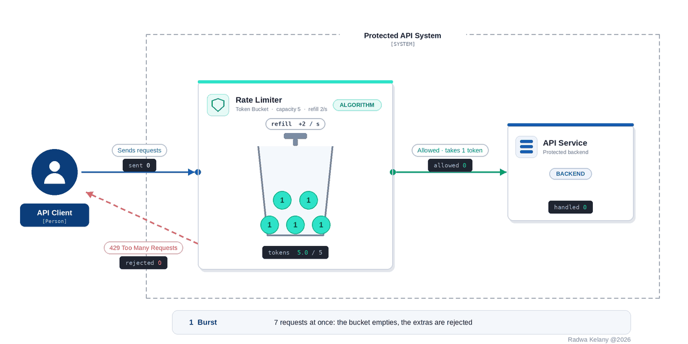

# Rate Limiter

## What it is

A rate limiter protects your system from receiving more requests than it can handle. Think of a traffic light at the entrance of a road: it lets traffic in while there is allowance, and holds it back when the limit is reached, so the road never gets jammed.

## How it works

A rate limiter depends on two things: **count** and **time**.

- **Count:** how much allowance is left. A request passes only while there is allowance.
- **Time:** what restores the allowance. How it is restored, in one shot or gradually, depends on the algorithm.

With these two, it works like this:

- While the client is within its limit, the limiter stays out of the way and requests pass through.
- When the count reaches zero, the limiter rejects new requests immediately (HTTP 429) without doing the real work.
- As time passes, the allowance is restored, and requests can pass again.

## Purpose

- Protect the service from too much traffic
- Keep capacity fair between clients
- Stop abuse and accidental floods
- Reject fast instead of letting requests pile up

## Rate limiting algorithms

All algorithms answer the same question: is there allowance left for this request? They differ in how they count, and in how time restores the allowance.

### Fixed window

Time is split into fixed windows (for example, 1 minute), and each window has a counter. A request passes if the counter is below the limit. When the window ends, the counter resets to zero in one shot.

- **Good:** very simple and cheap.
- **Weak:** the boundary problem. A client can use the full limit at the end of one window and again at the start of the next, so up to double the limit passes in a short time.

### Sliding window

Fixes the boundary problem by looking at the last N seconds from now, instead of a fixed block of time. It has two common versions:

- **Sliding window log:** stores the time of every request and counts those inside the last N seconds. Accurate, but uses more memory.
- **Sliding window counter:** combines the counts of the current and previous windows, weighted by how far we are into the current window. Cheap, but only an approximation.

### Token bucket

A bucket holds tokens, and each request takes one. Tokens are added gradually at the refill rate, up to the capacity. If the bucket is empty, the request is rejected.

- **Good:** allows short bursts (up to the capacity) but still enforces the average rate (the refill rate). Cheap to run, with two values per key.
- **Weak:** the burst allowed by the capacity can still reach the service all at once.

### Leaky bucket

Requests enter a bucket (a queue) and leave it at a fixed rate, like a leak at the bottom. If the bucket is full, new requests are rejected.

- **Good:** the output is smooth and steady, with no bursts reaching the service.
- **Weak:** it does not allow bursts, and queued requests wait, which adds delay.

### Comparison

| Algorithm | How the allowance is restored | Bursts | Main trade-off |
|---|---|---|---|
| Fixed window | One shot, at the end of the window | Allowed, and up to double at the boundary | Simple, but has the boundary problem |
| Sliding window | Gradually, as old requests leave the window | Limited | More accurate, but costs more memory or calculation |
| Token bucket | Gradually, by elapsed time × refill rate | Allowed, up to the capacity | Allows bursts, simple and cheap |
| Leaky bucket | Fixed outflow rate | Smoothed out, not allowed | Steady output, but adds delay |

**Road analogy:**

- **Fixed window:** the guard hands out a full stack of passes at the start of every hour.
- **Sliding window:** the guard counts how many cars entered in the last hour, at any moment.
- **Token bucket:** the guard drops passes into a box at a steady pace. Cars take one each, and a full box allows a rush.
- **Leaky bucket:** the guard lets cars in at a fixed pace, and the extra cars wait in a line.

**In this series, we focus on the token bucket.** It is one of the most common choices, and it shows both ideas clearly: count (the tokens) and time (the refill).

## Token bucket in action

**Settings:** capacity = 5, refill = 2 tokens/second. One client sends requests through the rate limiter to the API service.

**How to read the diagram:**

- Blue dots are requests travelling to the limiter.
- Green dots are allowed requests. They take one token and continue to the service.
- Red dots are rejected requests. They get **429 Too Many Requests** straight away.
- The bucket shows the tokens. The tap above it adds tokens at the refill rate, and the bucket never holds more than 5.
- The limiter card turns red with **LIMIT REACHED** when there is less than 1 token.

**On every request, the limiter does the same two steps:** refill first (`elapsed × refillRate`, capped at capacity), then check for at least 1 token.

### Phase 1: Burst

7 requests arrive at once, 0.05 s apart. Each gap earns only 0.1 token.

| # | Time (s) | Tokens before | Refill | After refill | Needed | Result | Tokens after |
|---|---|---|---|---|---|---|---|
| 1 | 1.10 | 5.0 | +2.2, capped | 5.0 | 1 | pass | 4.0 |
| 2 | 1.15 | 4.0 | +0.1 | 4.1 | 1 | pass | 3.1 |
| 3 | 1.20 | 3.1 | +0.1 | 3.2 | 1 | pass | 2.2 |
| 4 | 1.25 | 2.2 | +0.1 | 2.3 | 1 | pass | 1.3 |
| 5 | 1.30 | 1.3 | +0.1 | 1.4 | 1 | pass | 0.4 |
| 6 | 1.35 | 0.4 | +0.1 | 0.5 | 1 | **rejected** | 0.5 |
| 7 | 1.40 | 0.5 | +0.1 | 0.6 | 1 | **rejected** | 0.6 |

**Result:** 5 pass, 2 rejected. The full bucket pays for the burst, and the refill is too slow to earn more in that short time.

### Phase 2: Steady overload

The bucket is full again. Requests arrive every 0.25 s (4 per second), but the refill is only 2 per second. Each gap earns 0.5 token, and each request costs 1, so a passed request costs the bucket 0.5 token net.

- **Requests 1 to 9 pass.** The stored tokens pay for the extra traffic, and the bucket drains from 5 to 0.
- **Requests 10 to 17 alternate.** One gap earns only 0.5 token, so the request is rejected, but the 0.5 is kept. The next gap adds another 0.5, the bucket reaches 1.0, and that request passes.

**Result:** 13 pass, 4 rejected out of 17. After the bucket is empty, the limiter lets through 1 request every 0.5 s, which is exactly the refill rate. The limit holds the long-run average.

#### Step by step

**The key numbers per request:**

- Earned between requests: 0.25 s × 2/s = **+0.5 token**
- Cost of one request: **−1 token**
- Net effect of a passed request: **−0.5 token**

**Part A: draining (requests 1 to 9, all pass)**

| # | Time (s) | Tokens before | Refill | After refill | Needed | Result | Tokens after |
|---|---|---|---|---|---|---|---|
| 1 | 4.50 | 0.6 | long gap, capped | 5.0 | 1 | pass | 4.0 |
| 2 | 4.75 | 4.0 | +0.5 | 4.5 | 1 | pass | 3.5 |
| 3 | 5.00 | 3.5 | +0.5 | 4.0 | 1 | pass | 3.0 |
| 4 | 5.25 | 3.0 | +0.5 | 3.5 | 1 | pass | 2.5 |
| 5 | 5.50 | 2.5 | +0.5 | 3.0 | 1 | pass | 2.0 |
| 6 | 5.75 | 2.0 | +0.5 | 2.5 | 1 | pass | 1.5 |
| 7 | 6.00 | 1.5 | +0.5 | 2.0 | 1 | pass | 1.0 |
| 8 | 6.25 | 1.0 | +0.5 | 1.5 | 1 | pass | 0.5 |
| 9 | 6.50 | 0.5 | +0.5 | 1.0 | 1 | pass | 0.0 |

The limit is not reached yet. The stored tokens (the burst allowance) pay for the extra traffic. By request 9, the bucket is empty.

**Part B: the limit bites (requests 10 to 17, alternating)**

| # | Time (s) | Tokens before | Refill | After refill | Needed | Result | Tokens after |
|---|---|---|---|---|---|---|---|
| 10 | 6.75 | 0.0 | +0.5 | 0.5 | 1 | **rejected** | 0.5 |
| 11 | 7.00 | 0.5 | +0.5 | 1.0 | 1 | pass | 0.0 |
| 12 | 7.25 | 0.0 | +0.5 | 0.5 | 1 | **rejected** | 0.5 |
| 13 | 7.50 | 0.5 | +0.5 | 1.0 | 1 | pass | 0.0 |
| 14 | 7.75 | 0.0 | +0.5 | 0.5 | 1 | **rejected** | 0.5 |
| 15 | 8.00 | 0.5 | +0.5 | 1.0 | 1 | pass | 0.0 |
| 16 | 8.25 | 0.0 | +0.5 | 0.5 | 1 | **rejected** | 0.5 |
| 17 | 8.50 | 0.5 | +0.5 | 1.0 | 1 | pass | 0.0 |

**Why it alternates:** one gap earns only 0.5 token, which is not enough to pay 1, so the request is rejected. A rejected request takes no token, so **the 0.5 is kept**. The next gap adds another 0.5, the bucket reaches 1.0, and that request passes and spends it. Then the cycle repeats.

In Part B, the limiter lets through **1 request every 0.5 s, which is exactly the refill rate of 2 per second**. The client sends 4 per second, so half are rejected.

### Phase 3: Quiet

No requests arrive. The bucket is empty, and tokens drip back at 2 per second. After about 2.5 seconds it is full again (5 tokens), and any extra is discarded.

**Result:** the allowance is restored, so the next burst can pass again. A quiet client never saves more than the capacity.

### Totals

| Phase | Sent | Passed | Rejected |
|---|---|---|---|
| Burst | 7 | 5 | 2 |
| Steady overload | 17 | 13 | 4 |
| Quiet | 0 | 0 | 0 |
| **Total** | **24** | **18** | **6** |

**Road analogy:** the guard starts with a full box of 5 passes. In the burst, he hands them out quickly and turns the last cars away. When cars keep coming twice as fast as new passes arrive, he can only let one in each time he has collected a full pass. When the road is quiet, the box fills up again.