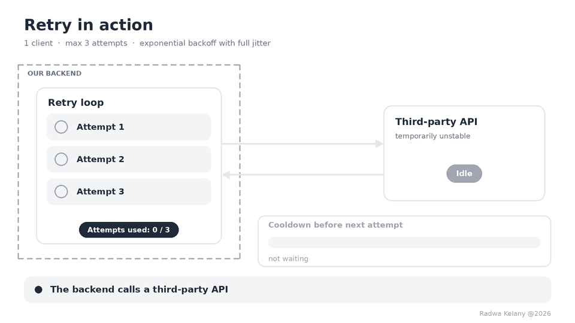

# Retry

## Introduction

You send a request to a service and it fails. Do you give up right away? Often that’s the wrong call. The failure may have lasted only a moment, and a second attempt would have worked.

A **retry** is the practice of repeating a failed request instead of treating the first error as final.

In distributed systems, most failures are transient. A request passes through a network, a load balancer and a third-party service, and any of these hops can fail briefly: a dropped packet, an instance restarting, a short overload. Such failures typically resolve within a second or two. Retry converts "failed for a moment" into "succeeded, with a small delay".

**The impact:** suppose a third-party API fails 1 in 100 requests for transient reasons.

| | Failures seen by users |
|---|---|
| No retry | 1 in 100 |
| Up to 3 attempts | about 1 in 1,000,000 |

This assumes failures are independent, which is typical of brief glitches.

A small change on the server side makes a big difference for the user: a better experience and a more reliable system.

## Factors to consider

We agreed that retry is important for our application. But does every error deserve a retry? And should we retry an unlimited number of times? These questions matter because they decide whether retry improves the system or just adds careless load to it. Five factors help us answer them.

### 1. Type of error
Not every failure will go away by itself. Transient failures such as 5xx responses, timeouts and dropped connections are worth retrying, because the next attempt may succeed. Errors such as 400, 404 and validation failures will fail again every time, so retrying them only wastes resources.

### 2. Weight of the service
The consequence of a duplicate or a failure sets how aggressive the retry can be. A notification can be retried many times, because a duplicate message is only annoying. A payment should be retried few times, because a careless retry can charge the customer twice.

### 3. Idempotency
Before repeating a request, we should ask whether it is safe to run twice. Reading data is harmless, but creating an order or a charge may not be. When an operation is not naturally safe, an idempotency key can make it safe to retry, because the server recognizes the repeated request and does not execute it again.

### 4. Cost of the request
The number of attempts is inversely related to the cost of the request. A quick, light query can be retried several times with little effect on the server. A long or heavy request should be retried fewer times, because each attempt consumes real server capacity.

### 5. Server load
Retrying a service that is already overloaded makes the overload worse. So retries must be limited in number and spread out over time, using **backoff** (waiting longer after each failed attempt) and **jitter** (adding a random delay so that clients don't all retry at the same moment).

## How it works

The retry mechanism wraps the request in a simple loop. The caller sends the request. If it succeeds, the process ends and the retry stops. If it fails, the caller checks the error type. An error outside the allowed types (400, 404, validation) is returned immediately, with no retry. An allowed error (5xx, timeout, dropped connection) on a call that is safe to repeat starts a retry: the caller increments the retry counter, waits for a cooldown period, and sends the request again. This repeats until a request succeeds or the counter reaches the allowed number of attempts. At that point the caller stops and returns the last error.

### The cooldown period

The cooldown gives the failing service time to recover. But how long should it be?

**A fixed cooldown has a problem.** Say 1,000 clients fail at the same moment, because the service restarted. With a fixed wait of 1 second, all 1,000 retry together after 1 second. If they fail again, they retry together again. The service gets hit by waves of traffic exactly when it is trying to recover. Two techniques solve this.

**Backoff** makes the wait grow after every failed attempt, usually by doubling it: 1 s, then 2 s, then 4 s. The longer the problem lasts, the more room the service gets. A maximum cap (for example 30 s) stops the wait from growing without limit.

**Jitter** adds randomness. Instead of waiting exactly 4 seconds, each client waits a random time between 0 and 4 seconds. Clients that failed together no longer retry together, so the retries spread out over time instead of arriving as one wave.

The two work as a pair. Backoff controls **how long** the waits are, and jitter controls **when** each client actually retries.

| Retry | Backoff limit | Actual wait (random) |
|---|---|---|
| 1 | 1 s | between 0 and 1 s |
| 2 | 2 s | between 0 and 2 s |
| 3 | 4 s | between 0 and 4 s |

## Retry limit and retry budget

Backoff and jitter control *when* a retry happens. Two limits control *how much* retrying is allowed: one per request, and one for the whole system.

### The retry limit

The retry limit is the maximum number of attempts for a single request. Once the counter reaches it, the caller stops and returns the last error. Without it, a request that keeps failing would be retried forever, holding resources and sending load to a service that is already struggling.

The right number depends on the factors we saw earlier: a notification can have many attempts, a payment only a few. A second limit is often added next to it, a **total time limit**. A user waiting on a screen can't wait through five long cooldowns, so the caller also stops when the allowed time has passed, even if attempts remain. A call that is not safe to repeat gets only one attempt (see the idempotency rule below).

### Why a per-request limit is not enough

Each request respects its limit, but the limits add up. Say a service handles 1,000 requests per second, each allowed 3 attempts in total. If the service goes completely down, every request fails and is retried, so the service now receives up to 3,000 requests per second. A per-request limit cannot see this, because each request only knows about itself.

### The retry budget

A retry budget limits retries across **all** requests. For example: retries may not exceed about 10% of normal traffic. When the budget is used up, new failures are not retried and the error is returned immediately.

The effect is simple:

- **Healthy system:** failures are rare, retries are few, and the budget is never reached.
- **Real outage:** the budget runs out quickly, retries stop, and the extra load stays small (about 1.1× instead of 3×).

### Link to the rate limiter

The retry budget is a **`TokenBucket` from Part 2**, created once per provider with its own capacity and refill rate. It is a separate bucket from the rate limiter's, because the two answer different questions: the rate limiter decides how much traffic may reach the provider, and the retry budget decides how much extra load retries may add.

- Only retries spend a token. The first attempt is free.
- Tokens return slowly over time.
- When the bucket is empty, no retry is allowed and the error is returned at once.

**The trade-off:** in a bad period, an empty budget means some users get an error immediately, instead of after a retry that might have worked. In exchange, the service is not buried under retries and can recover. The size of the budget controls this trade: a large budget protects the user experience, and a small one protects the service.

## The idempotency rule

Retry runs the same request again, and after some failures the caller cannot know whether the first request worked. After a timeout, one of two things happened: the request never reached the provider, or the provider processed it and only the answer was lost. A retry is safe in the first case. In the second case it can repeat the work, for example charge a customer twice.

An operation is **idempotent** if running it once or several times leaves the system in the same state. Reading a flight's details is idempotent. Charging a card is not, because every run charges again.

**The rule:** a call is retried only if it is safe to repeat. Otherwise it is sent once, and the first error is final. A call is safe to repeat in one of two ways:

- **An idempotency key.** The caller creates a unique key once per user action and sends the same key with every attempt. The provider remembers it: if the same key arrives again, it returns the result of the first run instead of executing again.
- **The `safeToRepeat` flag.** The caller states that a repeat does no harm, for example a read, or a notification where a duplicate is only annoying.

If neither is given, the call is sent once. This is the safe default: a forgotten option causes a missed retry, not a double charge.

| Call | Options | Attempts allowed | After a retryable failure |
|---|---|---|---|
| Charge a card | idempotencyKey | All | Retried with the same key. If the first charge worked, the provider returns that result. |
| Charge a card | none | 1 | Error returned at once. The outcome is unknown, so show "pending" and check the payment status. |
| Send a notification | safeToRepeat | All | Retried. A duplicate message is accepted. |
| Fare search | safeToRepeat | All | Retried. A read can run any number of times. |
| Create a booking | none | 1 | Error returned at once, even for a 503. Check whether the booking exists before trying again. |

### The payment guard

`safeToRepeat` is a claim by the caller, and the retry code cannot check it. Passing it for a payment without a key would allow a double charge. So a provider can be configured with `requireIdempotencyKey`. For that provider, only a key allows retries and `safeToRepeat` is ignored. An empty key counts as no key.

### Working with the key

- The key is created once per user action, before the first attempt. Every attempt sends the same key. A new key for each attempt would turn every attempt into a new payment.
- The retry code only checks that a key exists. The code that makes the request must put it in the request (usually a header), and the provider must support keys.
- If the final error reaches the user and they try the same payment again, the app reuses the same key. A new key is only for a new action.

## Working with the other rules

Retry doesn't work alone. It sits next to the circuit breaker and the rate limiter, and a few rules keep the three from working against each other.

### Retry-After

Sometimes the server tells us when to come back, with a `Retry-After` header on a 429 or 503 response. In that case the caller follows the server's value instead of its own backoff, because the server knows better than a guess. If the requested wait is longer than the time we are allowed to spend, we stop and return the error rather than wait.

### Circuit breaker

If the circuit breaker is open, the caller does not retry. The service is already known to be failing, and another attempt would only be rejected. The retry code does not need to ask the breaker. Every attempt passes through the breaker, and an open breaker throws its own `CircuitOpenError`. That error is not a `RequestError`, so the retry stops at once instead of waiting and trying again.

A failed attempt counts as a failure for the breaker like any other, so retries that keep failing help the breaker open. The breaker's `isServiceFailure` option decides which errors count, and it must recognize our `RequestError`: timeouts, connection errors and 5xx count. This is the "stop calling" side, and retry is the "try again" side, so they need to agree.

### The 429 question

A 429 means the service is healthy but we are sending too much. Should it count as a failure in the circuit breaker?

- **No.** Counting it would open the breaker for a service that is working fine. Like 400 and 404, it is a response about the caller's behavior, not about the service's health. The Part 1 breaker already works this way, because it counts only status 500 and above.
- **What we do instead:** wait for `Retry-After`, then retry within the limit and the budget.

### Retry at one layer only

If the client, the backend and a gateway all retry 3 times, one failure becomes 27 calls. Only the layer closest to the failing call retries. The layers above it fail fast and pass the error up. The exception is a failure before the backend is reached, because that is a different hop.

## Which errors are retried

"Retryable" means the error passes the error type check. The call must also be safe to repeat, and the attempts, the time limit and the budget must allow it.

### HTTP errors

| Status | Name | Cause | Retryable? |
|---|---|---|---|
| 400 | Bad Request | The request is invalid: wrong data or format | No, it fails again |
| 401 | Unauthorized | Missing or invalid credentials | No, fix the credentials first |
| 403 | Forbidden | The caller has no permission | No |
| 404 | Not Found | The resource doesn't exist | No |
| 409 | Conflict | The request conflicts with the current state, for example a duplicate | No |
| 422 | Unprocessable Entity | The data failed validation | No |
| 429 | Too Many Requests | The caller sent more than its allowance | Yes, after the `Retry-After` wait |
| 500 | Internal Server Error | An unexpected failure on the server | Yes |
| 502 | Bad Gateway | A gateway got a bad answer from the server behind it | Yes |
| 503 | Service Unavailable | The service is down, restarting or overloaded | Yes, follow `Retry-After` if present |
| 504 | Gateway Timeout | A gateway got no answer in time from the server behind it | Yes, but the request may have been processed |

The rule is simple: a 429 or any status from 500 up is retryable. Every other status is not.

### Failures without an HTTP answer

| Kind | Cause | Retryable? |
|---|---|---|
| `timeout` | No answer within the allowed time: a slow service or a network problem | Yes. The request may have been processed. |
| `connection` | The connection failed: refused, reset, or the address was not found | Yes |
| `cancelled` | Our own side cancelled the request | No |

### Errors that are not a RequestError

| Error | Cause | Retryable? |
|---|---|---|
| `CircuitOpenError` | The circuit breaker is open or has a probe in progress | No. It is not a `RequestError`, so the retry stops by itself. |
| `Error`, `TypeError` and so on | A bug in our own code | No. A retry would repeat the bug. |

Two cases where the simple rule is not perfect: a 408 (Request Timeout) is a 4xx, so it is not retried, although some servers use it for a slow client. A 501 or 505 is a 5xx, so it is retried, although these errors are permanent. They are rare, and the attempt limit stops them quickly.

## One policy per provider

Each provider has its own retry policy, in the same way that each provider has its own bucket in the rate limiter. A payment provider and a notification provider need different numbers and different rules about duplicates.

```ts
const executor = new RetryExecutor({
  payment: {
    maxAttempts: 2,
    baseDelayMs: 500,
    maxDelayMs: 2000,
    totalTimeoutMs: 5000,
    budget: { capacity: 5, refillRate: 1 },
    requireIdempotencyKey: true,
  },
  notification: {
    maxAttempts: 5,
    baseDelayMs: 1000,
    maxDelayMs: 30000,
    totalTimeoutMs: 120000,
    budget: { capacity: 20, refillRate: 2 },
  },
});

await executor.execute("payment", operation, { idempotencyKey });
await executor.execute("notification", operation, { safeToRepeat: true });
```

The numbers are examples, not rules. An unknown provider name throws an error.

| Setting | Meaning |
|---|---|
| `maxAttempts` | The most attempts for one call, the first included. A call that is not safe to repeat gets 1. |
| `baseDelayMs`, `maxDelayMs` | The start value and the cap of the backoff. |
| `totalTimeoutMs` | The most time one call may spend, waits included. |
| `budget` | The capacity and the refill rate (tokens per second) of the provider's retry budget. |
| `requireIdempotencyKey` | If true, only a key allows retries. |

### The order of the checks

After a failed attempt, the checks run in this order. If any of them fails, the last error is returned and the retry stops:

1. Is it a `RequestError`, and is it retryable?
2. Are there attempts left? (`maxAttempts` if the call is safe to repeat, otherwise 1)
3. Pick the delay: the server's `Retry-After` value if there is one, otherwise backoff with jitter.
4. Does the delay fit in the time limit?
5. Does the budget have a token?

If all five pass, the caller waits for the delay and sends the next attempt. The budget check is last on purpose: a token is spent only when the retry will really happen, so an earlier check never wastes one.

## Retry in action



The diagram follows one client calling a flaky third-party API, with a call that is safe to repeat. The rules are: at most 3 attempts, a backoff limit that doubles after each failure (1 s, then 2 s), and full jitter, which means the actual wait is a random value between 0 and the limit.

### Phase 1: the first attempt fails
The backend sends the request and the API answers with a 503. The caller checks the error type: a 5xx is transient, so a retry is allowed. The attempts counter shows 1 of 3.

### Phase 2: first cooldown
The backoff limit is 1 s. Jitter picks a random wait between 0 and 1 s, in this example 0.6 s. The caller waits for exactly that time and does nothing else.

### Phase 3: the second attempt times out
The request goes out again, but no response arrives, and the caller gives up after the timeout. A timeout is also transient, so a retry is allowed. The counter shows 2 of 3.

### Phase 4: second cooldown
Backoff doubled the limit to 2 s. Jitter picks 1.3 s from the range 0 to 2 s. The wait is longer than the first one, which gives the service more room to recover.

### Phase 5: the third attempt succeeds
The API answers with 200 OK. The caller stops retrying and returns the result. The user never saw an error, only a small delay.

### Phase 6: an error that is not retried
For a different request, the API answers with 400 Bad Request. The same request would fail again every time, so the caller returns the error at once, with no cooldown and no retry.

### Summary

| Attempt | Result | Retry allowed? | Wait before next attempt |
|---|---|---|---|
| 1 | 503 | Yes, transient | 0.6 s (limit 1 s) |
| 2 | Timeout | Yes, transient | 1.3 s (limit 2 s) |
| 3 | 200 OK | Not needed | None |
| Other request | 400 | No, it will fail again | None |

The wait values are random examples. Another run of the same sequence would pick different numbers inside the same limits.